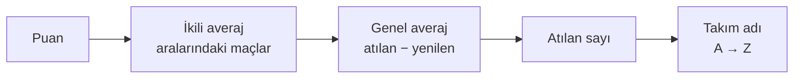
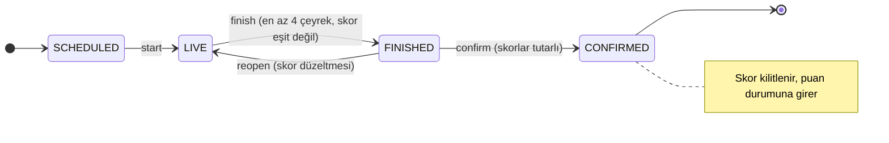
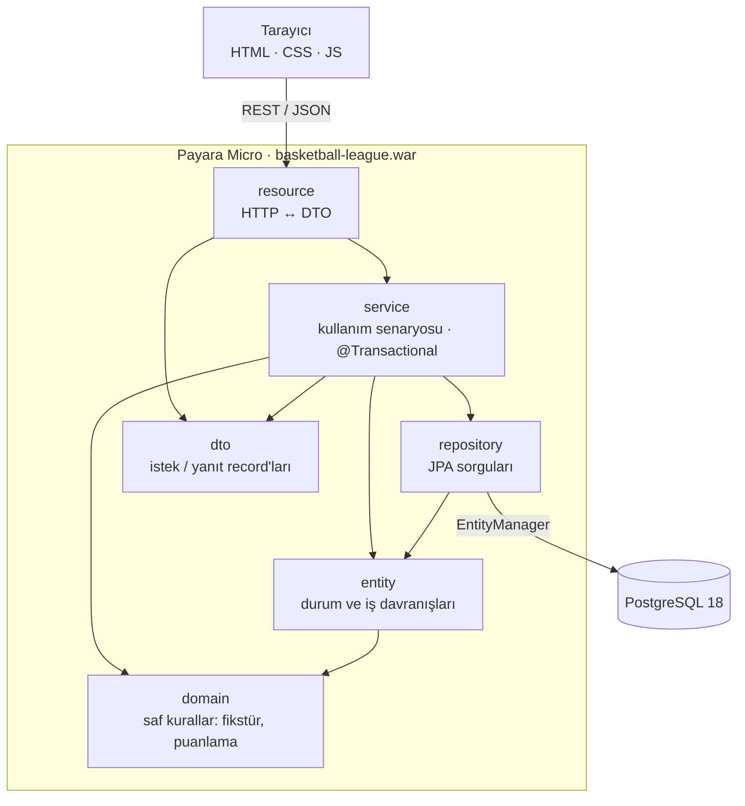
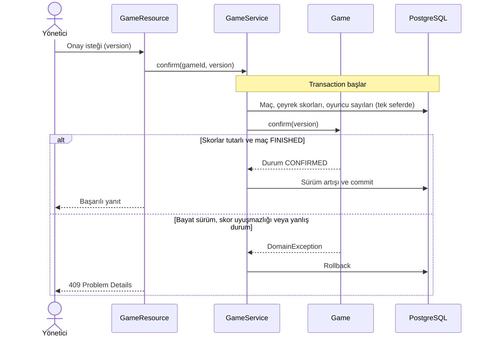

# Basketball League Manager

[](https://github.com/software-lecture-labs/basketball-league-manager/actions/workflows/build.yml)


Bir basketbol liginin fikstürünü, maç sonuçlarını ve puan durumunu otomatik yöneten web uygulaması.
Yönetici veriyi girer, sistem hesaplar, herkes güncel tabloyu görür.

> [!NOTE]
> Başlangıç verisi olarak gerçek EuroLeague takım ve oyuncu **adları** kullanılır. Skorlar, transferler ve
> istatistikler **demo verisidir**; resmî EuroLeague sonucu değildir. Logo, amblem ve resmî marka görseli kullanılmaz.

## İçindekiler

- [Özellikler](#özellikler)
- [Lig kuralları](#lig-kuralları)
- [Mimari](#mimari)
- [Teknolojiler](#teknolojiler)
- [Kurulum ve çalıştırma](#kurulum-ve-çalıştırma)
- [Testler ve kalite](#testler-ve-kalite)
- [Hata yönetimi ve loglama](#hata-yönetimi-ve-loglama)
- [Veri kaynağı](#veri-kaynağı)
- [Mimari karar kayıtları (ADR)](#mimari-karar-kayıtları-adr)
- [Çalışma düzeni](#çalışma-düzeni)
- [Ekip](#ekip)

---

## Özellikler

> [!NOTE]
> Bu README **v0.5** sürümünü anlatır. "Planlandı" olarak işaretli özellikler bu sürümde yoktur; ertelenen
> işler [issue](https://github.com/software-lecture-labs/basketball-league-manager/issues) listesinde izlenir.

İki tür kullanıcı vardır:

- **Lig yöneticisi:** takım ve oyuncu ekler, sezon ve fikstür oluşturur, skor girer ve onaylar.
- **Ziyaretçi (oyuncu, taraftar):** giriş yapmadan yalnızca görüntüler.

| Özellik                    | Durum     | Açıklama                                                                           |
| -------------------------- | --------- | ---------------------------------------------------------------------------------- |
| Takım ve oyuncu yönetimi   | ✔         | Ekleme ve listeleme. Oyuncu için yalnızca ad, soyad, forma numarası, pozisyon.     |
| Otomatik fikstür           | ✔         | Sezondaki takımlar için çift devreli fikstür; takım sayısı tek veya çift olabilir. |
| Maç sonucu                 | ✔         | Çeyrek çeyrek skor (1–4, gerekirse 5+ uzatma) ve oyuncu başına sayı girişi.        |
| Maç onayı                  | ✔         | Skorlar tutarlıysa maç onaylanır ve kilitlenir; onaylı maç puan durumuna girer.    |
| Puan durumu                | ✔         | Onaylı maçlardan her okumada yeniden hesaplanır; ayrı bir tabloda saklanmaz.       |
| Takım sezon özeti          | ✔         | Takımın sezondaki puan durumu satırı ve son beş onaylı maçı.                       |
| Takım ve oyuncu güncelleme | Planlandı | Kayıtlar şimdilik yalnızca eklenir.                                                |
| Hafif canlı skor           | Kısmen    | `LIVE` durumu ve çeyrek girişi var; birkaç saniyede bir yenilenen canlı sayfa yok. |
| Transfer                   | Planlandı | Oyuncunun takımı ve transfer kaydı aynı transaction içinde değişecek.              |
| İstatistik liderleri       | Planlandı | Onaylı maçlardan maç başına sayı ortalaması (PPG = toplam sayı / oynanan maç).     |

### Sayfalar

Sayfalar aynı WAR içinde statik HTML/CSS/JS'tir ve REST API'yi çağırır; adresler
`http://localhost:8080/basketball-league/` altındadır.

| Sayfa           | Adres           | İçerik                                                                                   |
| --------------- | --------------- | ---------------------------------------------------------------------------------------- |
| Puan durumu     | `index.html`    | Sezon seçici, puan tablosu ve maç sonucu giriş formu (çeyrekler, oyuncu sayıları, onay). |
| Takımlar        | `teams.html`    | Takım listesi, kadro, takımın sezon özeti ve son beş maçı.                               |
| Fikstür         | `fixtures.html` | Haftalara göre maçlar, durum filtresi, çeyrek ve oyuncu sayılarını gösteren maç detayı.  |
| Yönetici paneli | `admin.html`    | Takım ve oyuncu ekleme, sezon oluşturma, sezona takım katma, fikstür üretme.             |

> [!WARNING]
> Kullanıcı girişi bu sürümün kapsamında değildir; yönetici paneli ve sonuç formu korumasızdır. Uygulamayı
> yalnızca yerel demo ortamında çalıştırın.

**Kapsam dışı:** EuroLeague'in resmî kuralları, playoff ve Final Four, faul ve ceza takibi, maç simülasyonu,
otomatik veri çekme (scraping), logo ve resmî görseller, oyuncuların ek kişisel verileri.

---

## Lig kuralları

EuroLeague'in resmî kuralları değil, **projenin kendi kuralları** geçerlidir.

### Puanlama ve sıralama

| Sonuç      | Puan |
| ---------- | ---: |
| Galibiyet  |    2 |
| Mağlubiyet |    1 |

Basketbolda beraberlik yoktur; normal süre eşit biterse 5 dakikalık uzatmalar oynanır. Puanı eşit takımlar şu
zincirle ayrılır; bir adım eşitliği bozamazsa sonraki adıma geçilir:



Örnek: 10 maçta 8 galibiyet ve 2 mağlubiyet alan takımın puanı `8 × 2 + 2 × 1 = 18` olur.

### Fikstür

Fikstür, circle method (round-robin) algoritmasıyla üretilir ([ADR-0008](docs/adr/0008-fikstur-algoritmasi.md)).

- Her takım diğer her takımla iki kez karşılaşır; ikinci yarıda ev sahibi ve deplasman yer değiştirir.
- Bir takım aynı turda iki maç oynamaz. Takım sayısı tekse her tur bir takım bay geçer.
- Çift sayıda `n` takım için `2(n − 1)` tur ve `n(n − 1)` maç oluşur. Örneğin 18 takım: 34 tur, 306 maç.

Dört takımlı örnek (ilk yazılan ev sahibi):

| Tur | 1. maç | 2. maç |
| :-: | :----: | :----: |
|  1  | A – D  | C – B  |
|  2  | C – A  | B – D  |
|  3  | A – B  | D – C  |
|  4  | D – A  | B – C  |
|  5  | A – C  | D – B  |
|  6  | B – A  | C – D  |

### Maç ve skor kuralları

- Maç 4 × 10 dakika, uzatma 5 dakikadır (bilgi amaçlı; süre takibi yapılmaz).
- Skor ve sayılar negatif olamaz.
- Maç skoru çeyrek skorlarının toplamına, takım skoru oyuncu sayılarının toplamına eşit olmalıdır.
- Forma numarası takım içinde tekildir (0–99). Pozisyonlar: `PG`, `SG`, `SF`, `PF`, `C`.

Maç yaşam döngüsü; geçersiz geçişler (ör. `SCHEDULED → CONFIRMED`) iş kuralı hatası verir:



Çeyrek skorları ve oyuncu sayıları maç `LIVE` iken girilir; oyuncu sayıları `FINISHED` iken de düzeltilebilir.
Uç noktalar ve hata kodları [docs/api.md](docs/api.md)'dedir.

---

## Mimari

Uygulama **katmanlı monolit** olarak tasarlandı: tek Maven modülü, tek WAR, tek PostgreSQL veritabanı, tek
uygulama sunucusu (Payara Micro). Gerekçe ve değerlendirilen alternatifler (modüler monolit, hexagonal,
vertical slice, mikroservis) [ADR-0001](docs/adr/0001-katmanli-mimari.md)'de anlatılır.



Oklar izin verilen bağımlılıkları gösterir; ters yöndeki her erişim mimari testlerde kırmızı yanar.

| Paket        | Sorumluluk                                                                                       |
| ------------ | ------------------------------------------------------------------------------------------------ |
| `resource`   | HTTP isteğini servise, servis sonucunu HTTP yanıtına çevirir. Repository veya entity'ye erişmez. |
| `service`    | Kullanım senaryosu, transaction sınırı ve entity ↔ DTO dönüşümü.                                 |
| `repository` | `EntityManager` ile entity yükler, kaydeder, sorgular.                                           |
| `entity`     | JPA entity'leri; durum değişiklikleri setter yerine `confirm()`, `transferTo()` gibi metotlarla. |
| `domain`     | Framework'ten bağımsız saf kurallar ve `DomainException` hiyerarşisi. Yalnızca JDK'ya bağlıdır.  |
| `dto`        | REST sözleşmesi. Entity hiçbir zaman REST'ten dönmez veya alınmaz.                               |
| `exception`  | Hataları Problem Details yanıtına çeviren `ExceptionMapper`'lar.                                 |
| `config`     | `RestApplication` (`/api`) ve `DataSourceConfig`; iş kuralı taşımaz.                             |

### Transaction örneği: maç onayı

Maç onayı tek bir `@Transactional` servis metodudur. Herhangi bir adım başarısız olursa değişikliklerin
hepsi geri alınır; maç `FINISHED` kalır ve puan durumu bu maçı saymaz. İstek, yöneticinin son gördüğü maç
sürümünü taşır; maç o arada değiştiyse onay 409 ile reddedilir (ADR-0004). Bu davranışlar
[GameServiceIT](src/test/java/com/basketballleague/integration/GameServiceIT.java) ile gerçek PostgreSQL'de sınanır.



Transfer, ikinci bir çok kayıtlı transaction örneği olarak planlandı (oyuncunun takımı ve transfer kaydı birlikte
değişir); bu sürümde yoktur.

### SOLID

- **Single Responsibility:** katmanlar ayrı işleri yapar; her servis tek bir iş alanıdır (`TeamService`,
  `FixtureService`, `GameService`, `StandingService` …). Puan tablosu hesabı veritabanından bağımsız
  `StandingsTable` sınıfındadır.
- **Open/Closed:** puanlama [`PointsPolicy`](src/main/java/com/basketballleague/domain/PointsPolicy.java)
  arayüzüyle (`StandardPointsPolicy`: 2/1), eşitlik bozma
  [`TieBreaker`](src/main/java/com/basketballleague/domain/TieBreaker.java) zinciriyle yapılır (Strategy).
  Yeni bir kural, mevcut kuralları değiştirmeden yeni bir sınıf olarak zincire eklenir.
- **Liskov Substitution:** dört `TieBreaker` (ikili averaj, genel averaj, atılan sayı, takım adı) aynı
  karşılaştırma sözleşmesine uyar; `StandingsComparator` hangisi olduğunu bilmeden kullanır. Her biri
  [TieBreakerTest](src/test/java/com/basketballleague/domain/TieBreakerTest.java)'te sınanır.
- **Interface Segregation:** `PointsPolicy` ve `TieBreaker` tek metotlu arayüzlerdir; her repository yalnızca
  kendi aggregate'inin sorgularını içerir.
- **Dependency Inversion:** sıralama somut kurallara değil `TieBreaker` ve `PointsPolicy` soyutlamalarına bağlıdır.
  Bağımlılıklar CDI ile kurucudan enjekte edilir, zaman `Clock` üzerinden okunur (ikisini de ArchUnit korur).
  Repository'ler için ayrı arayüz yazılmadı: tek uygulama (JPA) var; bu bilinçli bir sadeleştirmedir.

### Proje yapısı

```text
basketball-league-manager/
├── docs/
│   ├── adr/                  # Mimari karar kayıtları
│   ├── api.md                # REST API sözleşmesi
│   └── testing/              # Mimari test planı
├── scripts/                  # Demo sezonu betikleri (demo-sezon.sh, demo-sezon.ps1)
├── src/main/java/com/basketballleague/
│   ├── config/               # RestApplication, DataSourceConfig
│   ├── domain/               # FixtureGenerator, PointsPolicy, TieBreaker, DomainException, record'lar
│   ├── dto/
│   ├── entity/
│   ├── exception/            # ExceptionMapper'lar, Problem Details
│   ├── repository/
│   ├── resource/
│   └── service/
├── src/main/resources/
│   ├── META-INF/persistence.xml
│   └── db/migration/         # Flyway migration'ları (V1–V5)
├── src/main/webapp/          # Sayfalar: index, teams, fixtures, admin (HTML/CSS/JS)
├── src/test/java/com/basketballleague/
│   ├── architecture/         # ArchUnit kuralları
│   └── integration/          # Testcontainers PostgreSQL 18 testleri (*IT)
├── .env.example              # Yerel ortam değişkenleri şablonu
└── pom.xml
```

---

## Teknolojiler

| Teknoloji                   | Sürüm                    | Kullanım                               |
| --------------------------- | ------------------------ | -------------------------------------- |
| Java (Temurin)              | 21                       | Programlama dili                       |
| Jakarta EE Web API          | 11.0.0                   | JAX-RS, CDI, JPA, JTA, Bean Validation |
| Payara Micro                | 7.2026.9                 | Uygulama sunucusu                      |
| PostgreSQL                  | 18                       | Veritabanı (JDBC sürücüsü 42.7.14)     |
| Maven Wrapper               | —                        | Derleme; ayrıca Maven kurmak gerekmez  |
| JUnit 5 · AssertJ · Mockito | 5.14.4 · 3.27.7 · 5.24.0 | Birim testleri                         |
| ArchUnit                    | 1.5.1                    | Mimari kuralların testi                |
| JaCoCo                      | 0.8.16                   | Test kapsamı raporu                    |
| Flyway                      | 13.13.0                  | Şema migration'ları                    |
| Testcontainers · EclipseLink | 2.0.5 · 5.0.0           | PostgreSQL 18 entegrasyon testleri     |
| SLF4J + `slf4j-jdk14`       | 2.0.20                   | Loglama (ADR-0006)                     |

---

## Kurulum ve çalıştırma

### Gereksinimler

- JDK 21
- PostgreSQL 18
- Payara Micro 7.2026.9 JAR dosyası ([indirme sayfası](https://www.payara.fish/downloads/))
- Windows, macOS veya Linux

### 1. Veritabanını oluşturun

`psql` ile yönetici kullanıcısında çalıştırın. Şifreyi kendiniz belirleyin; gerçek şifre repoya yazılmaz.

```sql
CREATE USER basketball WITH PASSWORD '<yerel-sifreniz>';
CREATE DATABASE basketball_league OWNER basketball;
```

### 2. Ortam değişkenlerini hazırlayın

Bağlantı bilgileri kaynak koddan değil, ortam değişkenlerinden okunur:

| Değişken      | Örnek                                                |
| ------------- | ---------------------------------------------------- |
| `DB_URL`      | `jdbc:postgresql://localhost:5432/basketball_league` |
| `DB_USER`     | `basketball`                                         |
| `DB_PASSWORD` | yerel veritabanı şifreniz                            |

`.env.example` dosyasını `.env` adıyla kopyalayıp değerleri doldurun. `.env` git tarafından yok sayılır.

```bash
cp .env.example .env
```

> [!IMPORTANT]
> Payara `.env` dosyasını kendiliğinden okumaz. Değişkenleri, Payara'yı başlatacağınız terminale yükleyin.

**macOS / Linux:**

```bash
set -a; source .env; set +a
```

**Windows (PowerShell):**

```powershell
Get-Content .env | Where-Object { $_ -match '^[A-Z_]+=' } | ForEach-Object {
    $name, $value = $_ -split '=', 2
    Set-Item "env:$name" $value
}
```

### 3. Şemayı oluşturun (Flyway)

Tablolar `src/main/resources/db/migration/` altındaki Flyway migration'larıyla oluşturulur. Uygulama
açılırken migration çalıştırmaz; ortam değişkenlerini yüklediğiniz aynı terminalde şunu çalıştırın:

```bash
./mvnw flyway:migrate         # macOS / Linux
.\mvnw.cmd flyway:migrate     # Windows
```

`flyway:info` hangi migration'ların uygulandığını gösterir.

> [!IMPORTANT]
> Uygulanmış bir migration dosyası asla değiştirilmez; her değişiklik yeni bir `V<sıradaki>__<açıklama>.sql`
> dosyasıyla yapılır. Değiştirilmiş dosya Flyway'in checksum doğrulamasında hata verir.

### 4. Derleyin

```bash
./mvnw clean package        # macOS / Linux
.\mvnw.cmd clean package    # Windows
```

WAR dosyası `target/basketball-league.war` olarak oluşur.

### 5. Payara Micro ile başlatın

Aynı terminalde, `<payara-micro.jar>` yerine indirdiğiniz JAR dosyasının yolunu yazın:

```bash
java -jar <payara-micro.jar> --deploy target/basketball-league.war --contextroot /basketball-league --nocluster
```

`--nocluster`, gereksiz Hazelcast kümesini ve macOS güvenlik duvarı uyarısını önler.

### 6. Kontrol edin

```bash
curl http://localhost:8080/basketball-league/api/ping
```

```json
{ "status": "UP", "timestamp": "2026-11-15T10:00:00Z" }
```

`timestamp` isteğin işlendiği andır (UTC).

> [!TIP]
> Ortam değişkenlerinden biri eksikse veya veritabanına bağlanılamıyorsa uygulama yüklenmez ve
> `/api/ping` **404** döner. Payara'nın konsol çıktısındaki dağıtım hatasına bakın.

### 7. Demo sezonu (isteğe bağlı)

Migration'lar yalnızca şemayı ve takımları yükler; sezon ve fikstür uygulamadan üretilir. Uygulama çalışırken
ikinci bir terminalde şu betik, ada göre ilk altı takımla bir demo sezonu oluşturur ve fikstürünü üretir:

```bash
scripts/demo-sezon.sh          # macOS / Linux (curl ve jq gerekir)
.\scripts\demo-sezon.ps1       # Windows PowerShell
```

Takım sayısı değiştirilebilir (`scripts/demo-sezon.sh 8`, `.\scripts\demo-sezon.ps1 -TeamCount 8`; 2-20 arası).
Betik tekrar çalıştırılabilir: var olan sezonu kullanır, üretilmiş fikstürü yeniden üretmez. Sonrasında fikstür
`http://localhost:8080/basketball-league/fixtures.html` adresinde görünür. Sayfayı VS Code "Go Live" ile değil,
Payara üzerinden açın; API yalnızca Payara'da çalışır.

Betik yerine yönetici panelinden (`admin.html`) de sezon kurulabilir; maç sonuçları ana sayfadaki
(`index.html`) formdan girilip onaylanır. Bütün sayfalar [Sayfalar](#sayfalar) bölümündedir.

> [!NOTE]
> Windows "running scripts is disabled" derse betiği bu oturum için izin vererek çalıştırın:
> `powershell -ExecutionPolicy Bypass -File .\scripts\demo-sezon.ps1`

---

## Testler ve kalite

```bash
./mvnw -B clean verify        # macOS / Linux (Docker gerekir: *IT entegrasyon testleri)
.\mvnw.cmd -B clean verify    # Windows (Docker gerekir: *IT entegrasyon testleri)
```

Yalnızca birim ve mimari testleri Docker olmadan çalıştırmak için:

```bash
./mvnw -B test                # macOS / Linux
.\mvnw.cmd -B test            # Windows
```

`verify` komutu derler, birim ve mimari testler ile Testcontainers PostgreSQL 18 entegrasyon testlerini (`*IT`)
koşar ve JaCoCo raporunu `target/site/jacoco/index.html` dosyasına yazar.

**Mimari testler** ([ArchitectureTest](src/test/java/com/basketballleague/architecture/ArchitectureTest.java))
derleyicinin yakalayamadığı kuralları korur:

- Katman bağımlılıkları ADR-0001'deki tabloya uyar; her sınıf belgelenmiş bir pakettedir.
- `domain` paketi `jakarta`, `javax` ve `java.sql` tiplerine bağımlı değildir.
- `@Transactional` yalnızca `service` paketinde kullanılır.
- Alan enjeksiyonu (`@Inject` alan) yoktur; bağımlılıklar kurucudan gelir.
- Entity'lerde public setter yoktur.
- Domain hataları tek bir `DomainException` tabanından türer.
- `Instant.now()` gibi gizli saat çağrıları yerine `Clock` enjekte edilir.
- `System.out`, `System.err` kullanılmaz; `util`, `common`, `helper`, `misc` paketi açılmaz.

**GitHub Actions:** `main` ve `dev`'e her push ve PR'da derleme ve testler (`Build`), CodeQL güvenlik taraması,
PR'lara boyut ve alan etiketleri.

### Statik analiz (SonarQube)

Analiz yerel SonarQube Community 26.11 ile, varsayılan "Sonar way" kural seti ve kalite kapısıyla yapılır.
Ayarlar `pom.xml`'dedir; sunucu adresi ve token komut satırından verilir, repoya yazılmaz:

```bash
./mvnw -B clean verify sonar:sonar -Dsonar.host.url=http://localhost:9000 -Dsonar.token=<token>
```

v0.5 sonucu (28 Kasım 2026):

| Ölçüm                           | Sonuç                                              |
| ------------------------------- | -------------------------------------------------- |
| Quality Gate                    | Geçti                                              |
| Güvenilirlik / Güvenlik / Bakım | A / A / A                                          |
| Bug / Açık / Güvenlik noktası   | 0 / 0 / 0                                          |
| Kod kokusu                      | 0                                                  |
| Test kapsamı (Java)             | %91.7 (satır %92.3, dal %90.1)                     |
| Tekrarlanan satır               | %0.8                                               |
| Analiz edilen kod               | 7527 satır: Java 3333, JS 1922, CSS 1496, HTML 465 |

Arayüz JS'i bug ve kod kokusu için taranır ama birim testi olmadığından kapsam hesabına girmez; kapsam
yalnızca Java'yı ölçer. Kapsam raporu `verify` ile `target/site/jacoco/index.html` dosyasına da yazılır.

---

## Hata yönetimi ve loglama

Kararlar [ADR-0006](docs/adr/0006-hata-yonetimi-ve-loglama.md)'dadır. Hatalar
[RFC 9457 Problem Details](https://www.rfc-editor.org/rfc/rfc9457) biçiminde
(`application/problem+json`) döner. İstemciye istisna mesajı, SQL hatası veya stack trace gönderilmez; ayrıntı
yalnızca sunucu logundadır.

| Durum                                    | HTTP     | `code`                                      | Log seviyesi                        |
| ---------------------------------------- | -------- | ------------------------------------------- | ----------------------------------- |
| Alan doğrulama hatası (Bean Validation)  | 400      | `VALIDATION_FAILED` + `errors` listesi      | DEBUG                               |
| Gövde okunamıyor, bozuk JSON             | 400      | `MALFORMED_REQUEST`                         | DEBUG                               |
| Kayıt bulunamadı                         | 404      | kayda özel, ör. `TEAM_NOT_FOUND`            | DEBUG                               |
| Desteklenmeyen yöntem veya içerik türü   | 405, 415 | `HTTP_405`, `HTTP_415` …                    | DEBUG                               |
| İş kuralı ihlali (`DomainException`)     | 409      | kurala özel, ör. `INVALID_FIXTURE_INPUT`    | INFO                                |
| Eşzamanlı güncelleme (optimistic lock)   | 409      | `CONCURRENT_UPDATE`                         | INFO                                |
| Veri bütünlüğü ihlali (unique, FK)       | 409      | `DATA_CONFLICT`                             | WARN                                |
| Beklenmeyen hata                         | 500      | `INTERNAL_ERROR`                            | ERROR (stack trace yalnızca burada) |

- `code` kalıcıdır; istemci karar verirken `detail` metnine değil `code`'a bakar. İş kuralı kodlarının tam
  listesi [`ErrorCode`](src/main/java/com/basketballleague/domain/ErrorCode.java)'dadır, Türkçe `detail`
  metinleri `ProblemCatalog`'dadır.
- Eşzamanlı güncelleme ve veri bütünlüğü hataları commit sırasında transaction istisnalarına sarılı gelebilir;
  sebep zinciri taranır. Kısıt adı ve SQL mesajı istemciye gönderilmez, yalnızca sunucu loguna yazılır.
- Loglama SLF4J API ve `slf4j-jdk14` bağlayıcısıyla yapılır; loglar Payara'nın `java.util.logging` altyapısına,
  yani sunucu konsoluna ve log dosyasına yazılır. `System.out` ve `printStackTrace` kullanılmaz (ArchUnit kuralı).

```json
{
    "type": "about:blank",
    "title": "Conflict",
    "status": 409,
    "detail": "Fikstür için birbirinden farklı en az iki takım gerekir.",
    "code": "INVALID_FIXTURE_INPUT"
}
```

---

## Veri kaynağı

Takım ve kadro verisi, kaynak sayfaların sabit sürümlerinden bir kez hazırlanıp Flyway seed migration'larına
yazıldı (`V2__seed_euroleague_2025_26_teams.sql`, `V5__seed_euroleague_2025_26_rosters.sql`). Uygulama veri
çekmez; canlı veri API'si kullanılmaz.

| Bilgi                      | Değer                                                                                          |
| -------------------------- | ---------------------------------------------------------------------------------------------- |
| Referans sezonu            | EuroLeague 2025-26 (30 Eylül 2025 - 24 Mayıs 2026), normal sezonun 20 kulübü                   |
| Takım kaynağı              | [Wikipedia: 2025–26 EuroLeague](https://en.wikipedia.org/wiki/2025%E2%80%9326_EuroLeague), "Qualified teams" |
| Kadro referans tarihi      | 1 Ocak 2026                                                                                    |
| Kadro kaynağı              | Her kulübün Wikipedia makalesindeki "Current roster" tablosunun bu tarihten önceki son sürümü (beş kulüpte tabloyu taşıyan sezon makalesi); sabit sürüm bağlantıları V5'in başında |
| Alınma tarihi              | Takımlar 20 Kasım 2026, kadrolar 25 Kasım 2026                                                 |
| Veri sürümü                | `euroleague-2025-26-teams-v1`, `euroleague-2025-26-rosters-v1`                                 |
| Takım alanları             | Ad (kaynaktaki yazımıyla, sponsorsuz), şehir (Türkçe yerleşik yazımıyla)                       |
| Oyuncu alanları            | Ad, soyad, forma numarası, pozisyon; 20 kulüp, 332 oyuncu                                      |
| Pozisyon eşlemesi          | PG, SG, SF, PF, C aynen; "X/Y" için ilk rol; G → SG, F → SF, GF → SF, FC → PF, CG → SG          |
| "00" forma numarası        | Kaynakta bir oyuncu (Armando Bacot) "00"; sayı sütunu "00" ile "0"ı ayıramadığı için 0           |
| Maç sonuçları, transferler | Uygulamada üretilen demo verisi; resmî EuroLeague sonucu değildir                              |

---

## Mimari karar kayıtları (ADR)

| ADR                                                     | Konu                                                               | Durum        |
| ------------------------------------------------------- | ------------------------------------------------------------------ | ------------ |
| [ADR-0001](docs/adr/0001-katmanli-mimari.md)            | Katmanlı monolit, EuroLeague veri kapsamı, puan durumunu hesaplama | Kabul edildi |
| [ADR-0002](docs/adr/0002-jakarta-ee-ve-payara-micro.md) | Jakarta EE 11 Web Profile ve Payara Micro                          | Kabul edildi |
| [ADR-0003](docs/adr/0003-entity-domain-modeli.md)       | Entity'ler domain nesnesi, sezon ve maç durum makineleri           | Kabul edildi |
| [ADR-0004](docs/adr/0004-mac-onayi-transaction.md)      | Maç sonucu, onay transaction'ı ve eşzamanlı değişiklikler          | Kabul edildi |
| [ADR-0006](docs/adr/0006-hata-yonetimi-ve-loglama.md)   | Hata yönetimi ve loglama politikası                                | Kabul edildi |
| [ADR-0008](docs/adr/0008-fikstur-algoritmasi.md)        | Fikstür üretimi için circle method                                 | Kabul edildi |

Mimari kuralların nasıl doğrulanacağı [mimari test planı](docs/testing/mimari-test-plani.md)'nda yer alır.

---

## Çalışma düzeni

- Her iş `dev` dalından açılan bir dalda yapılır: `feature/…`, `docs/…`, `chore/…`, `fix/…`.
- PR'lar `dev`'e açılır; CI yeşil olunca ve inceleme onayından sonra **merge commit** ile birleştirilir.
- Bir PR tek iş içerir; üretim kodu yaklaşık 400 satırı geçerse bölünür.
- Commit mesajı: İngilizce tür, Türkçe açıklama ve maddeli gövde.

```text
feat(fixture): çift devreli fikstür üreticisini ekle

- Circle method ile ilk yarıyı, ev/deplasman değişimiyle ikinci yarıyı üretiyor
- Neden: fikstürün elle hazırlanmasını ve tekrar eden eşleşmeleri önlemek
```

---

## Ekip

| Ad            | GitHub                                         |
| ------------- | ---------------------------------------------- |
| Ömer Ünlü     | [@OmerCN1](https://github.com/OmerCN1)         |
| Osman Balcı   | [@OsmanBlc](https://github.com/OsmanBlc)       |
| Mustafa Budak | [@Mustafabdk7](https://github.com/Mustafabdk7) |

Doğuş Üniversitesi, _Java Tabanlı Kurumsal Yazılım Geliştirme_ dersi dönem projesi. Eğitim amaçlıdır; resmî bir
EuroLeague ürünü değildir. EuroLeague adı ve takım adları hak sahiplerine aittir.
