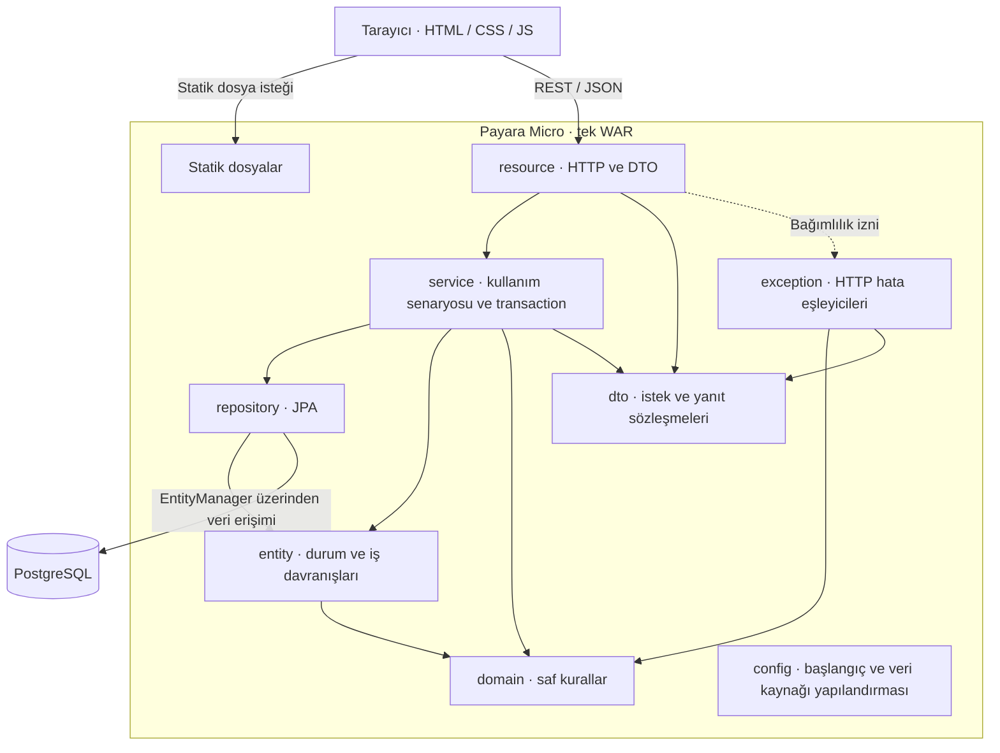

# ADR-0001: Katmanlı Monolit Mimari

## Bağlam

Basketball League Manager, EuroLeague takım ve oyuncu verilerini başlangıç verisi olarak kullanacak bir
basketbol ligi yönetim uygulamasıdır. Yönetici takım, oyuncu, sezon, fikstür ve maç sonuçlarını yönetir;
sistem girilen sonuçlardan puan durumu ve istatistik üretir. Görüntüleme ve veri girişi aynı ürünün parçalarıdır.

Proje üç kişilik bir ekip tarafından, dönem takvimi içinde ve ücretli altyapı bütçesi olmadan geliştiriliyor.
Her üyenin yazdığı kodu açıklayabilmesi, değişikliklerin küçük PR'larla incelenebilmesi ve uygulamanın
Application Server üzerinde gösterilebilmesi gerekiyor.

İşlerin önemli bölümü kayıt ekleme, güncelleme ve listelemedir. Bunun yanında fikstür üretimi, skor tutarlılığı,
maç durum geçişleri ve eşitlik bozma gibi bağımsız test edilmesi gereken kurallar vardır.
Maç onayı tutarlı doğrulama ve durum güncellemesi; transfer birden fazla kaydın birlikte değiştirilmesini gerektirir.

### EuroLeague verisinin kapsamı

Başlangıç veri kümesi için **tek bir sezon ve o sezon içindeki belirli bir referans tarihi** seçilecektir.
Amaç, bütün maç geçmişini toplamak değil, aynı kadrolarla yeniden kurulabilen bir başlangıç sağlamaktır.

- Sezon ve kesin tarih henüz seçilmemiştir. Kaynak bağlantıları, referans ve veri alma tarihleri kaydedilecektir;
  kaynak, kadronun temsil ettiği tarihi desteklemelidir.
- Gerçek transferler otomatik izlenmez; başlangıç kümesinin yenilenmesi ayrı veri sürümü olarak belgelenir.
- Fikstürü uygulama üretir; skorları ve transferleri yönetici girer. Bunlar resmî sonuç değil, demo sezonu verisidir.
- Projenin tanımlı lig kuralları korunur; EuroLeague'in bütün kuralları ve playoff yapısı kapsama eklenmez.

Canlı veri API'si gerekmez; başka lig kadroları da aynı mimaride kullanılabilir.
Kaynak ve yeniden kullanım koşulları örnek veri işinde değerlendirilir; bu ADR veri kullanım izni değildir.

### Kararı belirleyen ihtiyaçlar

Değerlendirme; bağımlılık, değişikliklerin birlikte kalması, test edilebilirlik, işletim maliyeti ve bilişsel yük
ölçütlerine dayanır. Dersin Bölüm 06 notlarındaki bu ölçütlere verilen cevaplar projeye özgüdür. [1]

| Soru                              | Projedeki durum                                                                               |
| --------------------------------- | --------------------------------------------------------------------------------------------- |
| Kaç bağımsız ekip var?            | Aynı ürün üzerinde çalışan üç kişilik tek ekip.                                               |
| Bağımsız yayın gerekiyor mu?      | Takım, fikstür ve maç işlemleri için ayrı yayın takvimi gerekmiyor.                           |
| İş alanları ne kadar ayrışmış?    | Maç, takım, oyuncu ve puan durumu ortak kullanım senaryolarında birleşiyor.                   |
| Farklı ölçekleme ihtiyacı var mı? | Bir parçanın ayrı ölçeklenmesini gerektiren ölçülmüş bir ihtiyaç yok.                         |
| Tutarlılık beklentisi ne?         | Onaylanan maç ve puan durumu aynı işlem sonunda birlikte görünmeli.                           |
| İşletim kapasitesi ne?            | Mevcut CI derleme ve test çalıştırıyor; çok servisli işletim altyapısı yok.                   |
| Test ihtiyacı ne?                 | Saf kurallar hızlı; kalıcılık ve transaction davranışları gerçek veritabanıyla test edilmeli. |

**Öncelik sırası:** Veri tutarlılığı, test edilebilirlik ve dönem içinde uçtan uca teslim önceliklidir.
Bağımsız dağıtım ve ayrı ölçekleme ihtiyacı olmadığı varsayımı, kullanım ölçümleriyle değişebilir.

### Kararın karşılaması gereken somut senaryolar

- Tek sayıda takımın bay kuralı, HTTP ve veritabanından bağımsız test edilir.
- Başarısız maç onayı puan durumunu etkilemez; yalnızca onaylanmış maçlar hesaplamaya katılır.
- Transfer kaydı oluşturulamazsa oyuncunun takım değişikliği de geri alınır.
- Yanıt alanı değişikliği DTO/mapper, sorgu değişikliği repository sorumluluğunda yönetilir.
- Geçersiz maç durumu, HTTP ayrıntısı taşımayan domain hatası üretir.

### Mevcut başlangıç noktası

[Maven yapılandırması] tek modüllü bir WAR üretir. [REST başlangıcı] ve [PingResource], HTTP çağrısını
[HealthService] üzerinden [PingResponse] DTO'suna dönüştüren ilk çalışan akışı sağlar.
[FixtureGenerator] ise Jakarta ve veritabanı bağımlılığı olmadan çalışan iş kuralı örneğidir.

[Persistence yapılandırması] JTA veri kaynağını tanımlar ve otomatik şema üretimini kapatır.
Entity ve repository paketleri henüz paket açıklamalarından oluşur; `exception` paketi henüz oluşturulmamıştır.
Maç onayı, transfer, gerçek veri erişimi, web sayfaları ve mimari testler tamamlanmış değildir.
Aşağıdaki karar bu alanların nasıl geliştirileceğini belirler.

## Karar

**Uygulamayı, tek Maven modülünden tek WAR olarak dağıtılan ve tek PostgreSQL veritabanını kullanan
klasik katmanlı monolit mimariyle geliştireceğiz.**

Monolit seçimi dağıtım sınırını, katmanlı yapı ise kodun sorumluluklarını ve bağımlılık yönünü tanımlar.
Java 21 ve Jakarta EE 11 ile geliştirilen uygulama Payara Micro üzerinde çalışacaktır.
Teknoloji ve sunucu alternatiflerinin ayrıntılı karşılaştırması ayrı bir karar belgesinin konusudur.

Ürün sınırları netleşirken bağımsız servis işletme maliyetini üstlenmiyoruz.
Bu tercih mevcut ihtiyaçlara dayanır; monolitin her durumda üstün olduğu iddia edilmez.

### Mantıksal katman ve fiziksel dağıtım ayrımı

`resource`, `service` ve `repository` aynı uygulamanın mantıksal katmanlarıdır; PostgreSQL ayrı bir hizmettir.
Tek WAR, veritabanının da aynı süreçte çalışması demek değildir (_layer_ ve _tier_ ayrımı). [1]

Service, repository yanında entity ve domain'i kullanabilir; yalnızca komşu katmana erişen katı bir zincir yoktur.
İzin verilen bağımlılıklar aşağıdaki tabloyla sınırlıdır; resource'ın repository'ye erişmesi yasaktır.

### Dağıtım ve istek akışı

Şema hedef yapıyı gösterir. Statik dosyalar WAR içinden sunulur; JavaScript tarayıcıda çalışır ve REST API'yi çağırır.
Tarayıcıdan çıkan oklar HTTP isteklerini, Java paketleri arasındaki oklar kullanım bağımlılıklarını gösterir.
Resource → exception kesikli oku bağımlılık iznidir; hata eşleyicilerini resource değil, JAX-RS çalıştırır.

### Paket sorumlulukları ve bağımlılıklar

Paketlerin kökü `com.basketballleague` olacaktır. Aşağıdaki erişim listesi proje içi paket bağımlılıklarını tanımlar;
JDK ve ilgili katmanın Jakarta API bağımlılıkları bu sütuna dahil değildir.

| Paket        | Sorumluluk                                                             | İzin verilen proje paketleri            |
| ------------ | ---------------------------------------------------------------------- | --------------------------------------- |
| `resource`   | HTTP isteğini servise, servis sonucunu HTTP yanıtına çevirir.          | `service`, `dto`, `exception`           |
| `service`    | Kullanım senaryosu, transaction ve dönüşüm.                            | `repository`, `entity`, `domain`, `dto` |
| `repository` | JPA ile entity yükler, kaydeder ve sorgular.                           | `entity`                                |
| `entity`     | Kalıcı durumu ve bu durumu değiştiren iş davranışlarını taşır.         | `domain`                                |
| `domain`     | Fikstür, puanlama ve benzeri saf kuralları tanımlar.                   | Başka proje paketi yok; yalnızca JDK.   |
| `dto`        | REST istek ve yanıt sözleşmelerini taşır.                              | Başka proje paketi yok.                 |
| `exception`  | Hataları HTTP hata yanıtına dönüştürür.                                | `domain`, `dto`                         |
| `config`     | Uygulama başlangıcı ve veri kaynağı yapılandırması; iş kuralı taşımaz. | Başka proje paketi yok.                 |

[REST başlangıcı] ve [DataSourceConfig] şu an kök pakettedir; ArchUnit kuralları eklenirken
`config` paketine taşınacaktır.
Domain'de `jakarta`, `javax`, `java.sql` bağımlılığı yoktur; DTO'larda doğrulama anotasyonları kullanılabilir.

### Katman sınırlarının uygulanması

1. **Resource yalnızca servisi çağırır.** İstek biçimini doğrular; iş hesabı veya `EntityManager` kullanımı içermez.
2. **REST sözleşmesi DTO'dur.** Entity alınmaz/döndürülmez; dönüşüm service paketindeki mapper'larda yapılır.
   Service'in DTO döndürmesi, şu an tek istemci REST API olduğu için bilinçli bir sadeleştirmedir;
   ikinci bir istemci eklenirse yeniden değerlendirilir.
3. **Service koordinasyonu üstlenir.** Service Layer yaklaşımına uygun olarak yükleme, transaction ve sonuç
   dönüşümünü yönetir. `GameService.confirm`, `Game.confirm(...)` davranışını çağırır;
   puan durumu servisi hesaplama sırasında `PointsPolicy` kullanır.
4. **Repository sorguları kapsüller.** JPQL ve `EntityManager` servise sızmaz. Servislerin bağımlı olduğu küçük
   arayüzler test nesnesi kullanımını sağlar; her sınıfa arayüz veya genel repository hiyerarşisi eklenmez.
5. **Entity veriyle davranışı birleştirir.** Domain Model yaklaşımı doğrultusunda public setter yerine `confirm()`
   ve `transferTo()` kullanılır. İş modeli entity ve saf domain'i kapsar; entity'de JPA bağımlılığı kabul edilir.
6. **Bağımlılıklar açıkça verilir.** Constructor injection ve mümkün olduğunca `private final` alanlar kullanılır.
   CDI/JPA kurucu gereksinimleri korunur; zaman `Clock` ile verilir.
7. **İş kuralı HTTP'den bağımsızdır.** `DomainException` alt türlerini HTTP'ye exception katmanı çevirir.
   Service HTTP yanıtı üretmez; resource eşleyicileri elle çağırmaz. Hata biçimi ayrı sözleşmededir.

Framework bağımsızlığı saf `domain` paketinde korunur; tüm iş modelinin JPA'dan bağımsız olduğu iddia edilmez.
Her isteğe boş katman metotları eklenmez: mevcut ping akışının repository'ye ihtiyacı yoktur.

### SOLID ilkelerinin bu tasarımdaki karşılığı

Tablo hedef davranışları gösterir; `PointsPolicy`, `TieBreaker` ve repository arayüzleri henüz uygulanmamıştır.

| İlke | Tasarımdaki karşılık                                           | İncelemede aranacak kanıt                         |
| ---- | -------------------------------------------------------------- | ------------------------------------------------- |
| SRP  | HTTP, işlem koordinasyonu ve sorgu ayrı sorumluluklardır.      | Resource içinde iş hesabı bulunmaması.            |
| OCP  | Puanlama ve eşitlik bozma davranışları stratejilerle ayrılır.  | Yeni stratejinin mevcut servise etkisi.           |
| LSP  | Aynı strateji sözleşmesinin tüm uygulamaları tutarlı davranır. | Ortak sözleşme ve davranış testleri.              |
| ISP  | Repository arayüzleri ihtiyaç duyulan işlemlerle sınırlanır.   | İstemcinin kullanmadığı işlemlere zorlanmaması.   |
| DIP  | Servis veri erişimi arayüzünü kurucudan alır.                  | JPA uygulaması yerine test nesnesi verilebilmesi. |

`Clock`, testte zamanı sabitlemeyi sağlar. [servis testi] mevcut örnektir; ortak CDI producer'ı henüz yoktur.

### Transaction sınırı: maç onayı örneği

Maç onayı, service katmanındaki transaction sınırı ile domain doğrulamasının birlikte çalışmasına örnektir.
Hedef akış şöyledir; ilgili sınıflar bu belgeyle birlikte uygulanmaz:

1. Resource, onay isteğini `GameService.confirm` kullanım senaryosuna iletir.
2. Service, maçı ve doğrulama için gerekli çeyrek skorları ile oyuncu istatistiklerini repository'lerden yükler.
3. `Game.confirm(...)`, maçın durumu ve skor tutarlılığını denetleyerek maçı `CONFIRMED` durumuna geçirir.
4. Güncelleme başarılıysa transaction tamamlanır; başarısızlıkta bu işlemin değişiklikleri geri alınır.
5. Puan durumu sonraki okumada onaylanmış maçlardan hesaplanır; onay sırasında ayrı puan kaydı güncellenmez.

Transaction sınırı service katmanındaki `@Transactional` kullanım senaryosudur; her repository çağrısı ayrı
bir işlem olarak tamamlanmaz. Jakarta'nın transaction desteği yönetilen nesneler üzerindeki çağrılarla çalışır;
testte servisi doğrudan oluşturmak bu davranışı kendiliğinden etkinleştirmez. [3]

Varsayılan `REQUIRED` davranışında mevcut transaction'a katılım veya yeni transaction başlatılması söz konusudur.
Varsayılan rollback davranışı checked exception ile `RuntimeException` için aynı değildir. [3]
Mevcut [DomainException], `RuntimeException` tabanından türer; buna rağmen hata yutulup normal yanıt üretilirse
beklenen başarısızlık akışı bozulabilir. Onay işleminin hata yolları da başarı yolu kadar test edilmelidir.

Tek WAR, veri tutarlılığını tek başına garanti etmez. Transaction sınırı gerçek çalışma ortamında doğrulanmalı;
aynı maça eşzamanlı müdahaleler `@Version` ile korunmalı ve çakışma testiyle kanıtlanmalıdır.
Birden fazla kaydın birlikte geri alınması transfer üzerinden gösterilir: oyuncunun takımı değiştirilir ve transfer
kaydı aynı transaction'da oluşturulur; kayıt oluşturulamazsa takım değişikliği de geri alınır.

### Puan durumunun üretilmesi

**Puan durumunu ayrı bir `standing` tablosunda saklamadan, yalnızca `CONFIRMED` maçlardan hesaplayacağız.**
İlk uygulamada repository sorgusu sezon bazında oynanan maç, galibiyet, mağlubiyet, atılan ve yenilen sayı toplamlarını
üretecek; puan hesabı `PointsPolicy`, sıralama ise domain'deki eşitlik bozma kurallarıyla yapılacaktır.
İkili averaj için takımların birbirleriyle oynadığı onaylanmış maç sonuçları da toplu sorguyla alınacaktır;
genel sezon toplamları bu hesabı tek başına karşılamaz.
Henüz onaylanmış maçı olmayan sezon takımları da sıfır değerlerle listelenecektir.

Ayrı tabloda toplam saklamak okumayı kolaylaştırır; ancak her onayda maçlarla uyumlu ek güncellemeler gerektirir.
Hesaplama yaklaşımı bu eşzamanlama yükünü ve aynı takımın ortak puan kaydı üzerindeki güncelleme çakışmasını kaldırır.
Karşılığında her okumada sorgu maliyeti oluşur. Mevcut lig ölçeğinde bu maliyetin yönetilebilir olduğu varsayımı
temsili sezon verisiyle ölçülecektir. Aynı maç üzerindeki eşzamanlı değişiklikler yine ayrıca korunacaktır.

Ölçülen sorgu maliyeti veya yeni ürün ihtiyaçları bu yaklaşımı yetersiz kılarsa karar ayrı bir ADR ile yeniden
değerlendirilecektir. Saklanan bir özet yapıya geçiş, güncellik ve eşzamanlılık kurallarıyla birlikte gerekçelendirilir.
Bu yeniden değerlendirme koşulu mevcut hesaplama kararını belirsiz bırakmaz; uygulama bu karara göre ilerler.

### Bu ADR'nin karar sınırı

| Burada belirlenen                          | Ayrı çalışmada ayrıntılandırılacak                                             |
| ------------------------------------------ | ------------------------------------------------------------------------------ |
| Tek dağıtım birimi ve paket bağımlılıkları | Jakarta/Payara seçiminin diğer teknolojilerle karşılaştırması.                 |
| Service üzerinde transaction sınırı        | Maç onayının kayıt modeli, transfer rollback ve kilitleme ayrıntıları.          |
| Puan durumunu onaylı maçlardan hesaplama    | Sorgu tasarımı, indeksler ve temsili sezon verisiyle performans doğrulaması.      |
| Entity davranışı ile saf domain ayrımı     | Entity eşlemeleri, tablo alanları, migration ve kimlik tipi.                   |
| Mimari kuralları testle koruma yaklaşımı   | ArchUnit uygulaması ve eşzamanlı güncelleme stratejisi.                        |

## Değerlendirilen Alternatifler

Bu seçenekler tek eksendeki karşıtlar değildir: modüler monolit katmanlar içerebilir;
hexagonal yapı tek WAR olarak dağıtılabilir. Karşılaştırma, mevcut kapsam için tercih edilen birleşimi açıklar.
Değerlendirmeler ekibin proje ihtiyaçlarına ilişkin nitel yorumlarıdır; performans ölçümü değildir.

| Alternatif                  | Güçlü olduğu koşul                 | Bu projede neden seçilmedi?                              |
| --------------------------- | ---------------------------------- | -------------------------------------------------------- |
| Katmansız tek uygulama      | Küçük, kısa ömürlü prototip.       | HTTP, veri erişimi ve iş kuralları iç içe geçebilir.     |
| Modüler monolit             | Belirgin iş modülleri.             | Başlangıçta ortak katman kuralları yeterli görülüyor.    |
| Hexagonal / Clean           | Dış sistemlerden güçlü yalıtım.    | Ek model ve adaptör düzeni şu an gerekli görülmüyor.     |
| Vertical Slice Architecture | Özellikleri kendi içinde toplama.  | Ortak katman sınırları tercih ediliyor.                  |
| Mikroservisler              | Bağımsız ekip, yayın ve ölçekleme. | Dağıtık işletim ve tutarlılık maliyeti gerekçelenemiyor. |

**Modüler monolit:** Tek WAR veya tek Maven modülü modüler bir yapıya engel değildir.
Burada tercih edilmeyen şey, takım, sezon ve maç alanları için ayrı modül API'lerini şimdiden tasarlamaktır.
Mevcut ekip bu alanları aynı teslim sürecinde geliştiriyor. Katmanlı yapıda özellik dosyalarının farklı paketlere
dağılmasını, daha az başlangıç yapısı karşılığında kabul ediyoruz.
Dersin Bölüm 09 örneğinde Northwind iş modüllerinin kendi içinde katmanlara ayrılması anlatılır. [2]
Bu projede o modül haritasını birebir almıyoruz: bağımsız iş ekipleri ve ayrı yayın ihtiyaçları bulunmuyor;
modüller arası veri sahipliği ve sözleşme yönetiminin maliyetini şimdilik üstlenmiyoruz.
Bu, modüler monolitin küçük ekipte kullanılamayacağı iddiası değildir. Güçlü bir alternatif olarak kalır;
özellikler arasındaki bağımlılıkları yönetmek zorlaşırsa ilk yeniden değerlendirme adaylarından biridir.

**Hexagonal / Clean:** İki yaklaşım aynı mimari değildir; ortak değerlendirme nedeni dış ayrıntıların iş
kurallarından uzak tutulmasına verdikleri önemdir. Uygulamayı farklı giriş ve veri erişim adaptörleriyle çalıştırma
ihtiyacı güçlenirse değerleri artar. Şimdilik saf algoritmaları domain'de tutup servis bağımlılıklarını arayüzlerle
tanımlamak, hedeflenen test ayrımını daha az yapıyla sağlar.
Bu yaklaşımların ayrı Maven modülleri gerektirdiğini veya her zaman daha fazla sınıf ürettiğini varsaymıyoruz.
Buradaki maliyet değerlendirmesi, tüm iş modelini JPA'dan ayıracak alternatifin bu projedeki uygulamasına ilişkindir.

**Vertical Slice Architecture:** Değişen bir özelliğin parçalarını birlikte tutmak avantajdır.
Bu projede ise servis, veri erişimi ve HTTP sınırlarının tüm özelliklerde aynı biçimde görünmesini tercih ediyoruz.
Bir özelliğin birden fazla pakette değişiklik gerektirmesi bu tercihin maliyetidir.
Ortak domain kuralları Vertical Slice yaklaşımında da paylaşılabilir; alternatif bu yeteneği olmadığı için elenmemiştir.

Özellikler migration'dan ekrana küçük PR'larla tamamlanır; kodun üst düzey paketleri katmanlara göre düzenlenir.
Bu teslim yöntemi, Vertical Slice Architecture seçimi anlamına gelmez.

**Mikroservisler:** Bağımsız dağıtım yararı mevcut ekipte gerekli değildir.
Maç onayını servisler ve ayrı veri sahiplikleri arasında dağıtmak, tutarlılık için ek koordinasyon gerektirir.
Tek uygulama yaklaşımıyla bu maliyeti üstlenmeden kullanım senaryosunu tamamlamayı hedefliyoruz.

## Sonuçlar

### Olumlu sonuçlar

- **Tek teslim birimi:** Arayüz ve API aynı WAR ile yayınlanır; ayrı frontend dağıtım süreci gerekmez.
- **İzlenebilir sorumluluklar:** HTTP, kullanım senaryosu, veri erişimi ve iş kuralları için belirli yerler vardır.
- **Yerel transaction:** Maç onayı ve transfer için aynı veritabanında tek işlem sınırı kurulabilir.
- **Ayrı test seviyeleri:** Saf kurallar sunucusuz, servisler taklit bağımlılıklarla,
  kalıcılık gerçek PostgreSQL ile sınanır.
- **Açıklanabilir tasarım:** Bir isteğin hangi sınıflardan geçtiği ve hangi kuralın nerede korunduğu gösterilebilir.

### Kabul edilen maliyetler

- **Birlikte yayın:** Küçük bir değişiklik için bile WAR yeniden dağıtılır; özellikler bağımsız yayınlanmaz.
- **Sınırlı izolasyon:** Aynı süreç ve kaynaklar paylaşılır. Bir bölümdeki kaynak tüketimi tüm uygulamayı etkileyebilir.
- **Paketlere yayılan değişiklik:** Bir özellik DTO, resource, service ve repository dosyalarına birlikte dokunabilir.
- **Dönüşüm maliyeti:** Entity'leri REST'ten ayırmak için DTO ve mapper kodu yazılır.
- **JPA bağımlılığı:** Entity katmanının kalıcılık teknolojisinden ayrılması ileride ek çalışma gerektirebilir.

### Riskler ve karşılıkları

| Risk                                        | Nasıl ele alınacak?                                                  |
| ------------------------------------------- | -------------------------------------------------------------------- |
| Resource'ın repository'ye doğrudan erişmesi | PR incelemesi ve planlanan ArchUnit bağımlılık kuralları.            |
| Servislerin bütün kuralları toplaması       | Durum davranışları entity'de, saf algoritmalar domain'de tutulur.    |
| İlgisiz kodun ortak paketlerde birikmesi    | Sorumluluğu belirli sınıflar; genel amaçlı paket adlarından kaçınma. |
| Monolit olmanın doğru transaction sayılması | Gerçek servis çağrısında rollback ve kalıcılık kanıtı.               |
| Katmanların yalnızca çağrı aktarması        | Her katmanın somut sorumluluğunu PR incelemesinde sorgulama.         |
| Eşzamanlı işlemlerin birbirini ezmesi       | İlgili kullanım senaryosunda kilitleme kararı ve çakışma testi.      |

### Kararı yeniden değerlendirme koşulları

Bağımsız ekip veya yayın ihtiyacı, ölçülmüş farklı ölçekleme gereksinimi ya da tekrarlayan sınır ihlalleri ortaya
çıkarsa bu karar yeniden ele alınır. Paketlere göre düzenleme değişiklikleri sürekli zorlaştırıyorsa özellik veya
modül sınırları yeniden değerlendirilir. Bu koşullar herhangi bir alternatif mimariye otomatik geçiş anlamına gelmez;
yeni ihtiyaç ve geçiş maliyeti ayrı bir ADR ile karşılaştırılır.

## Doğrulama

### Mevcut kanıtlar

| Gözlenen yapı               | Kanıt                                            | Kanıtın sınırı                                        |
| --------------------------- | ------------------------------------------------ | ----------------------------------------------------- |
| Tek Maven modülü ve WAR     | [Maven yapılandırması]                           | Payara dağıtımının çalıştığını tek başına kanıtlamaz. |
| Resource → service → DTO    | [PingResource], [HealthService], [PingResponse]  | Genel mimari denetim değildir.                        |
| Saf Java iş kuralı          | [FixtureGenerator] ve [fikstür testleri]         | Tüm domain için mimari bağımlılık testi değildir.     |
| Testte denetlenebilir zaman | [HealthService] ve [servis testi]                | Ortak CDI `Clock` producer'ı henüz yoktur.            |
| JTA veri kaynağı            | [Persistence yapılandırması], [DataSourceConfig] | İş transaction'ı kanıtı değildir.                     |

Katman bağımlılıkları ArchUnit ile, transaction davranışı entegrasyon testleriyle doğrulanacaktır.
Planlanan kurallar, doğrulama yöntemleri ve test altyapısının mevcut durumu
[Mimari test planında](../testing/mimari-test-plani.md) açıklanmıştır. Bu kontroller henüz uygulanmamıştır.

## Kaynaklar

Erişim tarihi: **7 Kasım 2026**. Ders notları incelenen commit'e bağlanmıştır.

1. **Software Lecture Labs — [Bölüm 06: Yazılım Mimarileri Üzerine Yardımcı Notlar][1].**
   Mimari karar ölçütleri, katman/dağıtım ayrımı ve alternatifler.
2. **Software Lecture Labs — [Bölüm 09: Maven Modülleri ve ArchUnit Kullanımı][2].**
   Northwind modül örneği ve mimari sınırların testlerle korunması.
3. **Eclipse Foundation — [Jakarta Transactions 2.0, bölüm 3.7][3].**
   Transaction yayılımı ve istisna türüne göre rollback davranışı.

[Maven yapılandırması]: ../../pom.xml
[REST başlangıcı]: ../../src/main/java/com/basketballleague/RestApplication.java
[PingResource]: ../../src/main/java/com/basketballleague/resource/PingResource.java
[HealthService]: ../../src/main/java/com/basketballleague/service/HealthService.java
[PingResponse]: ../../src/main/java/com/basketballleague/dto/PingResponse.java
[FixtureGenerator]: ../../src/main/java/com/basketballleague/domain/FixtureGenerator.java
[DataSourceConfig]: ../../src/main/java/com/basketballleague/DataSourceConfig.java
[Persistence yapılandırması]: ../../src/main/resources/META-INF/persistence.xml
[fikstür testleri]: ../../src/test/java/com/basketballleague/domain/FixtureGeneratorTest.java
[servis testi]: ../../src/test/java/com/basketballleague/service/HealthServiceTest.java
[DomainException]: ../../src/main/java/com/basketballleague/domain/DomainException.java
[1]: https://github.com/software-lecture-labs/study-notes/blob/d33d07147fb440a76ac89944a5655e2021073da7/java-chapter-06.md
[2]: https://github.com/software-lecture-labs/study-notes/blob/d33d07147fb440a76ac89944a5655e2021073da7/java-chapter-09.md
[3]: https://jakarta.ee/specifications/transactions/2.0/jakarta-transactions-spec-2.0.html
