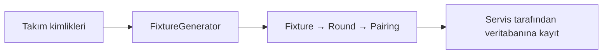

# ADR-0008: Fikstür Üretimi için Circle Method

## Bağlam

Lig yöneticisi bir sezonu başlattığında, sezondaki takımlar için çift devreli bir fikstür gerekir.
6 takımlı bir ligde bu, 10 tura dağılmış 30 maç demektir. Fikstürün elle hazırlanması hem zaman alır hem de
aşağıdaki kuralların gözden kaçmasına açıktır:

- Her takım diğer her takımla iki kez oynar: bir kez evinde, bir kez deplasmanda.
- Bir takım aynı turda en fazla bir maç oynar.
- Takım sayısı tekse her tur bir takım bay geçer ve bay hakkı takımlar arasında eşit dağılır.
- Ev ve deplasman maçları takımlar arasında dengeli dağılır.

Ayrıca fikstürün aynı girdiyle her zaman aynı sonucu vermesi (testlerin tekrarlanabilir olması için)
ve veritabanı ya da web katmanı olmadan test edilebilmesi gerekir.

Başlangıç verisi EuroLeague takımları ve referans tarihli kadrolardır; ADR-0001'e göre fikstürü uygulama üretir,
resmî maç takvimi veri olarak alınmaz. Sezona alınacak takım sayısı henüz seçilmediği için
algoritmanın belirli bir takım sayısına bağlı olmaması gerekir.

## Karar

**Fikstürü, `domain` paketindeki [FixtureGenerator] sınıfında circle method (round-robin) algoritmasıyla
üreteceğiz.** [1]

- Takımlar bir çembere dizilir. İlk konum sabit kalır, diğerleri her tur bir adım döner.
  Çemberin karşılıklı konumlarındaki takımlar eşleşir. Çift sayıda n takım için ilk yarı n−1 tur sürer.
- Ev sahibi/deplasman dengesi için sabit takımın sahası tur numarasına, diğer eşleşmelerin sahası konumlarına
  göre dönüşümlü belirlenir.
- İkinci yarı, ilk yarının aynı tur sırasıyla ve ev sahibi/deplasman yer değiştirmiş olarak oluşturulur.
- Takım sayısı tekse çembere sabit konumda boş bir yer eklenir; o yere denk gelen takım o tur bay geçer.
  Bu durumda ilk yarı n tur sürer.
- Sınıf saf Java'dır (Jakarta/JPA bağımlılığı yoktur). Sonuç değişmez record'larla ([Fixture], [Round],
  [Pairing]) döner; girdi listesi değiştirilmez.
- Geçersiz girdi (null liste, ikiden az takım, tekrar eden veya null kimlik) `DomainException`'dan türeyen
  `InvalidFixtureInputException` ile reddedilir. Aynı kural record'larda da korunur: bir takım kendisiyle
  eşleşemez, tur numarası 1'den küçük olamaz.

### Sorumluluk akışı

Üretici yalnızca eşleşmeleri ve turları hesaplar. Veritabanına kayıt, ileride eklenecek servisin sorumluluğudur.

### Dört takımlı örnek

Girdi sırası `[A, B, C, D]` olduğunda aşağıdaki fikstür üretilir. A–D, sayısal takım kimliklerinin kısa gösterimidir.
Her maçta ilk yazılan takım ev sahibidir.

| Tur | Birinci maç | İkinci maç |
| --- | --- | --- |
| 1 | A – D | C – B |
| 2 | C – A | B – D |
| 3 | A – B | D – C |
| 4 | D – A | B – C |
| 5 | A – C | D – B |
| 6 | B – A | C – D |

İlk üç turda her takım diğerleriyle bir kez karşılaşır. Son üç turda aynı eşleşmelerin ev sahibi ve deplasmanı değişir.
Toplam 6 tur ve 12 maç oluşur; her takım 3 kez evinde, 3 kez deplasmanda oynar.

## Değerlendirilen Alternatifler

| **Alternatif** | **Neden seçilmedi?** |
| --- | --- |
| Fikstürün yönetici tarafından elle girilmesi | Yavaş ve hataya açık; kuralların sağlandığını garanti eden bir mekanizma yok. |
| Seçilen sezonun resmî EuroLeague fikstürünü veri olarak almak | ADR-0001 başlangıç verisini takım ve kadrolarla sınırlar; resmî takvim bu ligin kurallarını (çift devre, seçilen takım kümesi) yansıtmaz ve elle veri girişini büyütür. |
| Rastgele eşleştirme ve geçersiz sonuçta yeniden deneme | Sonuç her çalıştırmada değişir, test edilmesi zordur; geçerli bir fikstür bulma süresi garanti değildir ve bay dağılımı kendiliğinden eşit olmaz. |
| Takım sayısına göre hazır Berger tabloları | Circle method ile aynı sonucu verir, ancak desteklenen her takım sayısı için ayrı tablo tutmayı gerektirir. Algoritma her takım sayısı için genel çalışır. |
| Ardışık ev/deplasman maçlarını en aza indiren optimizasyon (kısıt çözücü, tamsayı programlama) | Daha adil bir dağılım sağlar ancak ek kütüphane ve önemli bir karmaşıklık getirir; projenin kapsamı için gereğinden fazla. |
| Fikstürü servis katmanında üretmek | Bağımsız test edilebilir; ancak eşleştirme algoritması ile kullanım senaryosunun koordinasyonu aynı sınıfta toplanır. Saf iş kuralını ayrı tutmak için domain sınıfı seçildi. |
| Fikstürü veritabanı sorgularıyla üretmek | Algoritmayı veri erişimine bağlar. Saf Java uygulamasıyla eşleştirme kuralı veritabanı olmadan çalıştırılabilir ve test edilebilir. |

## Sonuçlar

- **Olumlu:** Fikstür kuralları birim testlerle kanıtlanır. Aynı girdi her zaman aynı fikstürü üretir.
  Sınıf container ve veritabanı olmadan test edilebilir. Sezon servisi fikstürü tek bir çağrıyla alır ve
  yalnızca kaydetmekle sorumlu olur.
- **Olumsuz:** Ardışık ev veya deplasman maçları (break) optimize edilmez; bazı takımlar arka arkaya iki ev ya da
  iki deplasman maçı oynayabilir. Toplam ev/deplasman sayıları ise her yarıda dengelidir
  (fark en fazla 1, tek takım sayısında 0).
- **Olumsuz:** Fikstür, girdi listesindeki takım sırasına bağlıdır; sıra değişirse farklı ama yine geçerli bir
  fikstür üretilir.
- **Risk:** Maç tarihlerinin ve salonların atanması bu sınıfın sorumluluğunda değildir. Aynı salonu paylaşan
  takımların çakışması gibi kurallar gerekirse ayrı bir adımda ele alınmalıdır.

## Doğrulama

Aşağıdaki davranışlar [FixtureGeneratorTest] sınıfındaki birim testlerle doğrulanır.

| Davranış | İlgili test |
| --- | --- |
| Çift n'de 2(n−1), tek n'de 2n tur; toplam n(n−1) maç | `generatesExpectedRoundAndMatchCounts`, `generatesTenRoundsAndThirtyMatchesForSixTeams` |
| Her takım her turda en fazla bir maç; bay geçen takım belirtilir | `schedulesEachTeamAtMostOncePerRoundAndReportsTheBye` |
| Her eşleşme tam bir kez evde, bir kez deplasmanda | `schedulesEveryOpponentOnceAtHomeAndOnceAway` |
| İkinci yarı, ilk yarının ev/deplasman ters hâli | `reversesVenuesInTheSameRoundAndPairingOrderForTheSecondHalf` |
| Tek takım sayısında herkes her yarıda bir kez bay geçer | `givesEachTeamExactlyOneByePerHalf` |
| Her yarıda ev/deplasman farkı en fazla 1 | `balancesHomeAndAwayCountsWithinEachHalf` |
| Aynı girdi aynı fikstürü verir; girdi değişmez | `generatesTheSameFixtureWithoutChangingInputOrder` |
| Sonuç listeleri değiştirilemez | `returnsImmutableListsAndCopiesRecordConstructorInputs` |
| Geçersiz girdi reddedilir | `rejectsInvalidInputWithDomainException`, `rejectsPairingAgainstTheSameTeam`, `rejectsRoundNumbersBelowOne` |

Domain paketinin framework'ten bağımsız kalması bu kararın değil, ADR-0001'in mimari kurallarının konusudur;
bu yüzden burada ayrıca ele alınmaz.

## Kaynaklar

Erişim tarihi: **13 Kasım 2026**.

1. **Wikipedia — [Round-robin tournament: Circle method][1].** Çember yöntemiyle tek devreli eşleştirme ve tek
   sayıda katılımcıda boş yer (bay) eklenmesi.

[1]: https://en.wikipedia.org/wiki/Round-robin_tournament#Circle_method
[FixtureGenerator]: ../../src/main/java/com/basketballleague/domain/FixtureGenerator.java
[Fixture]: ../../src/main/java/com/basketballleague/domain/Fixture.java
[Round]: ../../src/main/java/com/basketballleague/domain/Round.java
[Pairing]: ../../src/main/java/com/basketballleague/domain/Pairing.java
[FixtureGeneratorTest]: ../../src/test/java/com/basketballleague/domain/FixtureGeneratorTest.java
